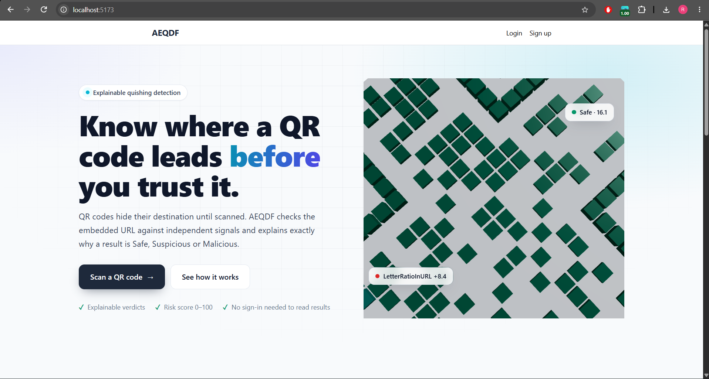
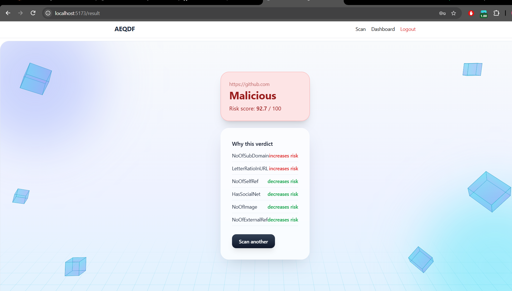
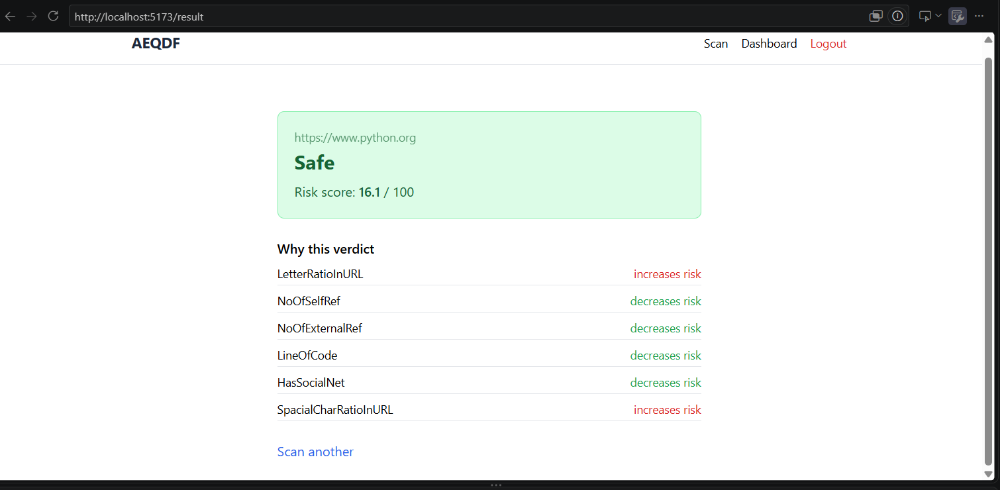
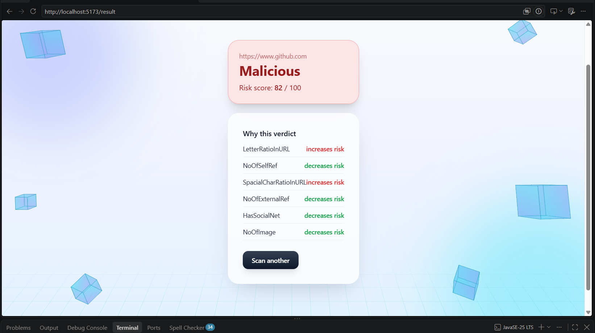

# AEQDF – Quishing Detection

> Detect malicious **QR-code phishing ("quishing")** by decoding QR codes, extracting URL features, and classifying them with a machine-learning model.


---

## Screenshots

| Home / Upload | Scan Result |
|---|---|
|  |  |

| Safe URL | Malicious URL |
|---|---|
|  |  |

---

## Overview

Quishing attacks hide phishing links inside QR codes, which bypass many email and URL filters. AEQDF scans a QR code, decodes the URL, extracts features from it, and predicts whether it is **safe** or **malicious**.

## Features

- QR code upload and decoding
- URL feature extraction (lexical, domain, SSL and reputation features)
- ML-based classification with a confidence score
- REST API (Node.js backend + Python ML service)
- Web frontend to view results
- Result persistence

## Architecture

```
Frontend  →  Backend (Node.js)  →  ML Service (Python, port 8000)
                  │
                  └── Feature Extractor → Database
```

| Layer | Tech |
|---|---|
| Frontend | React / HTML / JS *(edit to match)* |
| Backend | Node.js, Express |
| ML Service | Python, scikit-learn, FastAPI |
| Database | *(MongoDB / SQLite – edit)* |

## Project Structure

```
aeqdf/
├── backend/            # Node.js API
│   └── src/services/featureExtractor.js
├── frontend/           # Web UI
├── ml/                 # Training + inference service
├── docs/screenshots/   # README images
└── README.md
```

## Getting Started

### Prerequisites

- Python 3.10+
- Node.js 18+
- Git

### 1. Clone

```bash
git clone https://github.com/sum347173-creator/aeqdf-quishing-detection.git
cd aeqdf-quishing-detection
```

### 2. ML service

```bash
python -m venv venv
venv\Scripts\activate          # Windows
# source venv/bin/activate     # macOS / Linux
pip install -r requirements.txt
python train.py                # train the model
uvicorn app:app --port 8000    # start the service
```

### 3. Backend

```bash
cd backend
npm install
cp .env.example .env           # add your keys
npm start
```

### 4. Frontend

```bash
cd frontend
npm install
npm run dev
# open http://localhost:5173
```

## Usage

1. Open the web app.
2. Upload a QR code image.
3. The system decodes the URL, extracts features and returns a verdict with a confidence score.

### Example API call

```bash
curl -X POST http://localhost:8000/predict \
  -H "Content-Type: application/json" \
  -d '{"url": "http://example-login-verify.com"}'
```

```json
{ "prediction": "malicious", "confidence": 0.94 }
```

## Roadmap

- [ ] Real WHOIS / domain-age lookups in `domainIntelligence`
- [ ] Real TLS certificate checks in `sslInfo`
- [ ] Google Safe Browsing integration in `safeBrowsingCheck`
- [ ] Verify extractor feature names match `GET /feature-schema`
- [ ] Larger training dataset and model evaluation report
- [ ] Docker setup

## Model Performance

| Metric | Score |
|---|---|
| Accuracy | *xx%* |
| Precision | *xx%* |
| Recall | *xx%* |
| F1-score | *xx%* |

## Contributing

Pull requests are welcome. Please open an issue first to discuss major changes.

## License

MIT – see [LICENSE](LICENSE).

## Author

**sum347173-creator** – [GitHub](https://github.com/sum347173-creator)
